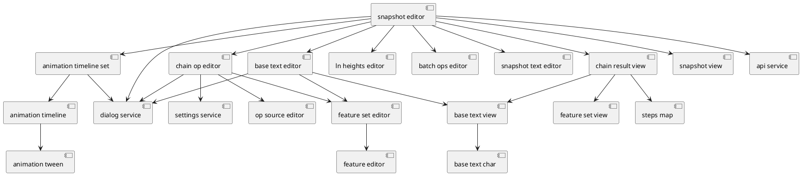

# Gve Core

- 🚀 `npm i @myrmidon/gve-core`.

This library was generated with [Angular CLI](https://github.com/angular/angular-cli) version 17.0.0. All the components in this library are standalone, and since version 3 their properties and events are signal-based.

This is the core UI library for [GVE](https://vedph.github.io/gve-doc).

## Snapshot Editor

The snapshot editor is the top-level component in the library and orchestrates the behavior of all the components included in it. Its API is very simple, as it just deals with a full snapshot:

- ▶️ `snapshot` (`Snapshot`): the snapshot to edit.
- ▶️ `batchOps` (`string`): the batch operations text to set for the editor.
- ▶️ `noSave` (`boolean`): true to disable saving.
- 🔥 `snapshotChange` (`Snapshot`): emitted when the user saves the edited snapshot.
- 🔥 `snapshotCancel` (`void`): emitted when the user cancels the snapshot editing.

The only data directly handled by the component are:

- size and style;
- base text and related data;
- background image.

Operations and timelines are handled by other children components. The snapshot model is built dynamically when required (via `getSnapshot`), and it is displayed by a snapshot view.

## Dependencies

- [@myrmidon/ngx-tools, @myrmidon/ngx-mat-tools](https://github.com/vedph/ngx-tools)
- [@myrmidon/gve-snapshot-view](https://github.com/vedph/gve-snapshot-view): the snapshot view. This is a pure TS library, no JS framework required. The component is a standard web component.
- [cisstech/nge](https://github.com/cisstech/nge) for a light Monaco editor wrapper.
- [@svgdotjs/svg.js](https://github.com/svgdotjs/svg.js/) for SVG manipulation.
- [gsap](https://gsap.com/) for animations.
